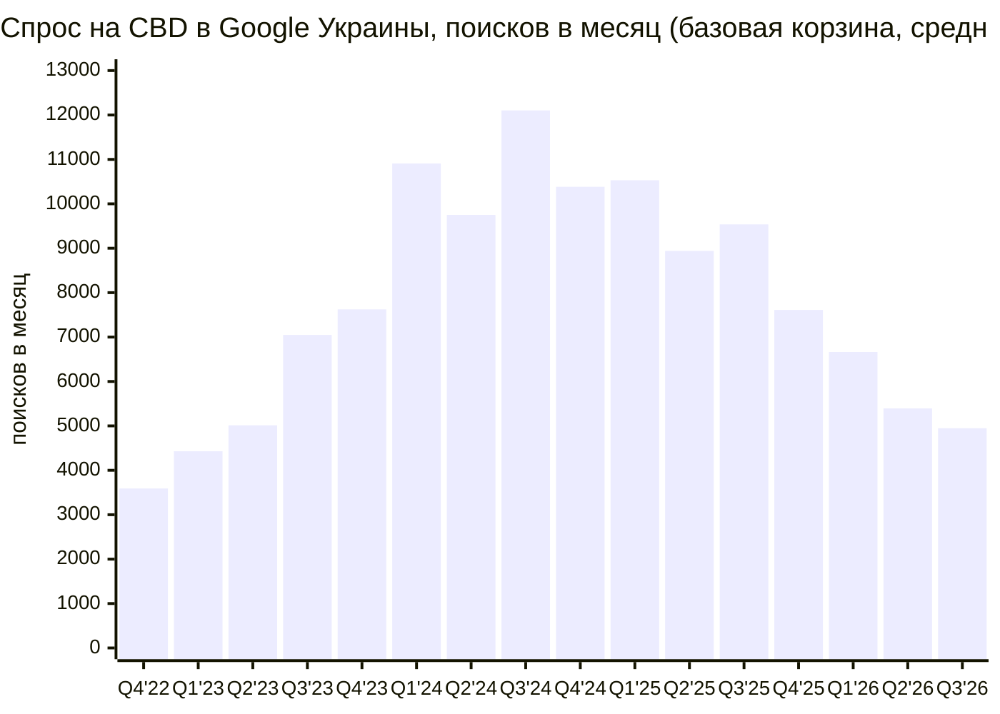

# Аудит рынка CBD в Украине: спрос в Google Search

*Дата: 18 октября 2026. Гео: Украина. Данные о спросе — Google Ads Keyword Planner, окт 2022 – сен 2026.*

---

## Вердикт коротко

**Спрос есть, но маленький, и он падает. Запускать отдельный CBD-магазин, который живёт на трафике из Google, сейчас экономически не оправдано.**

| Вопрос | Ответ |
|---|---|
| Есть ли спрос? | Да. Измерено **≈ 8 800 поисков в месяц** по 81 CBD-запросу (среднее за 12 мес.). Вместе со скрытым запросом «cbd» и длинным хвостом — **≈ 12–15 тыс. в месяц**. |
| Большой ли он? | Нет. Это уровень одной узкой ниши БАДов. Одна «ашваганда» даёт 33 100 в месяц, «мелатонін» — 40 500. Польский «olejek cbd» сам по себе (9 900) сопоставим со всей украинской CBD-категорией. |
| Растёт ли? | **Нет. За последние 12 месяцев −38% г/г.** Пик был в 2024 году (≈10 тыс. в месяц по базовой корзине), сейчас ≈5 тыс. — уровень 2023 года. Контрольная ниша (пищевое конопляное масло) за тот же период −10%. Значит, падение касается именно CBD, а не всего поиска. |
| Можно ли купить трафик? | **Нет.** Google Ads и Merchant Center запрещают рекламу CBD в Украине, у Meta и TikTok то же самое. Остаётся только SEO. |
| Насколько тяжела выдача? | Средне, но неудобно. Головные коммерческие запросы забирают аптечные агрегаторы (tabletki, Подорожник, АНЦ) и маркетплейсы (Prom, Rozetka). Специализированных магазинов 5–7, и большинство из них технически слабые. |
| Юридические риски? | Растут. Легален только **изолят с нулевым ТГК**. В 2026 году прошли три крупные волны уголовных дел против «CBD-магазинов»: Волынь, U420, Тернополь. Были сотни обысков и арест 416 счетов. |
| Сколько денег даёт Google? | Весь органический поток покупок CBD из Google — порядка **250 тыс. грн в месяц (≈ $6 тыс.) на весь рынок**. Новый магазин в базовом сценарии через 12–18 месяцев выйдет на **≈ 25 тыс. грн в месяц выручки**. Это меньше, чем стоит хорошее SEO в YMYL-нише. |

**Когда заходить всё-таки имеет смысл:**
- у вас уже есть аптека, магазин БАДов или зоомагазин, и CBD становится ещё одной категорией;
- или вы строите **собственный бренд изолята**, который продаётся в основном через аптеки и маркетплейсы, а Google остаётся вспомогательным каналом.

Подробно — в [разделе 9](#9-стоит-ли-заходить-и-если-да--то-как).

---

## Содержание

1. [Методология и ограничения данных](#1-методология-и-ограничения-данных)
2. [Объём спроса](#2-объём-спроса)
3. [Динамика за 4 года](#3-динамика-за-4-года)
4. [Структура спроса: интент, язык, гео, форматы](#4-структура-спроса-интент-язык-гео-форматы)
5. [Бенчмарки: насколько это много](#5-бенчмарки-насколько-это-много)
6. [Конкуренты и выдача](#6-конкуренты-и-выдача)
7. [Платный трафик: что можно, а что нет](#7-платный-трафик-что-можно-а-что-нет)
8. [Правовой статус и риски](#8-правовой-статус-и-риски)
9. [Стоит ли заходить и если да — то как](#9-стоит-ли-заходить-и-если-да--то-как)
10. [Экономика: сценарии](#10-экономика-сценарии)
11. [Файлы с данными](#11-файлы-с-данными)
12. [Источники](#12-источники)

---

## 1. Методология и ограничения данных

**Откуда данные о спросе.** Это Google Ads Keyword Planner через подключённый аккаунт (валюта UAH). Метод — `generateKeywordHistoricalMetrics`, гео — Украина (`geoTargetConstants/2804`), все языки, сеть Google Search. Проверено около 170 формулировок на украинском, русском и латинице. Для 29 ключевых запросов взята помесячная история за 48 месяцев.

**Почему нельзя просто «попросить идеи у Google».** Генератор идей Keyword Planner по семенам `cbd`, `канабідіол`, `cbd олія` вернул всего **6 подсказок**. Подсказки по всей CBD-тематике Google режет, потому что она относится к ограниченным категориям. Объёмы пришлось собирать вручную, запрос за запросом.

**Что Google скрывает:**
- Метрики для **главного запроса `cbd` не выдаются вообще**. В Польше то же самое, значит это политика Google, а не особенность Украины.
- Не выдаются данные по `hhc`, `каннабис`, `медицинский каннабис`, `cbd vape`, `cbd для собак` и ещё примерно 55 формулировкам. Полный список — в CSV, сегмент «Нет данных».
- Поэтому измеренные цифры **занижены**. Скрытую часть я оцениваю отдельно и всегда явно помечаю как оценку.

**Другие ограничения:**
- Keyword Planner округляет объёмы до «корзин» (10, 20, 30… 1000, 1300, 1600…).
- Близкие варианты он объединяет, например «cbd купити» и «cbd купить».
- Выдачу Google UA напрямую посмотреть не удалось: из среды исследования доступ к google.com закрыт. Конкурентов я восстанавливал по индексам веб-поиска, сайтам игроков, маркетплейсам и публикациям СМИ. Выводы о позициях в выдаче поэтому косвенные.

**Неоднозначные запросы.** `сбд` (1 600), `cbd це` (1 600), `cbn` (590), `цбд` (320) и `cbg` (210) **в итог не включены**. В них много постороннего смысла (CBN, CBG и аббревиатуры). Я использую их только как ориентир для оценки скрытого `cbd`.

---

## 2. Объём спроса

### 2.1. Итог

| Показатель | Поисков в месяц |
|---|---:|
| Измерено, 81 CBD-запрос, среднее окт 2025 – сен 2026 | **8 840** |
| — из них коммерческие (масла, покупка, формы, вейпы, животные, бренды) | 5 320 |
| — из них общие и информационные | 3 520 |
| Текущий темп (сентябрь 2026) по базовой корзине относительно среднего за 12 мес. | ≈ 81% |
| **Оценка:** скрытый главный запрос `cbd` | ≈ 2 000–4 000 |
| **Оценка:** длинный хвост, не попавший в выборку | ≈ 15–25% к измеренному |
| **Оценка всего спроса на CBD в Google Украины** | **≈ 12–15 тыс.** (и снижается) |

Оценку скрытого `cbd` я считал по соотношению латиницы и кириллицы в похожих парах. `cbd олія` / `кбд олія` = 6,5×, `cbd масло` / `кбд масло` = 2,8×. Применил его к запросу `кбд` (590 в месяц). Косвенно оценку подтверждают `сбд` (1 600) и `cbd це` (1 600): похоже, Google частично относит к ним «голый» запрос cbd.

### 2.2. Спрос по сегментам (измеренный, 12 мес.)

| Сегмент | Поисков в месяц | Доля | Запросов |
|---|---:|---:|---:|
| B. Масло / олія (без слова «купить») | 2 800 | 32% | 12 |
| A. Общие head-запросы (канабідіол, кбд, каннабидиол) | 2 370 | 27% | 3 |
| G. Информационные (що таке, відгуки, эффект, как принимать) | 1 150 | 13% | 18 |
| C. Покупка / цена / город | 1 130 | 13% | 21 |
| D. Вейпы | 740 | 8% | 7 |
| E. Другие формы (капсулы, конфеты, чай, крем, изолят) | 380 | 4% | 9 |
| H. Бренды и магазины | 160 | 2% | 6 |
| F. Для животных | 110 | 1% | 5 |
| **Итого** | **8 840** | 100% | 81 |

### 2.3. Топ-30 запросов

Для сводной таблицы смысловые дубли объединены через «/». CPC и ставки указаны в грн.

| Запрос | Поисков в мес. | Конкуренция | Ср. CPC | Ставка верха страницы | Сегмент |
|---|---:|---|---:|---:|---|
| канабідіол | 1 300 | LOW | — | — | Общие |
| cbd олія | 720 | HIGH | 35 | 5–31 | Масло |
| cbd масло | 720 | HIGH | 23 | 4–23 | Масло |
| кбд | 590 | LOW | — | — | Общие |
| каннабидиол | 480 | LOW | 37 | 5–15 | Общие |
| cbd вейп | 480 | HIGH | 15 | 5–15 | Вейпы |
| cbd oil | 390 | HIGH | 33 | 6–34 | Масло |
| масло cbd | 320 | HIGH | 22 | 5–22 | Масло |
| cbd купити / купить | 320 | LOW | — | — | Покупка |
| канабідіол це | 320 | LOW | — | — | Инфо |
| кбд масло | 260 | HIGH | 31 | 7–33 | Масло |
| канабідіол купити | 170 | LOW | — | — | Покупка |
| что такое cbd | 170 | LOW | — | — | Инфо |
| що таке cbd | 170 | LOW | — | — | Инфо |
| кбд олія | 110 | HIGH | 26 | 10–39 | Масло |
| кбд купити / купить | 110 | HIGH | 14 | 6–23 | Покупка |
| cbd вейп купити / купить | 110 | LOW | — | — | Вейпы |
| олія cbd | 90 | HIGH | 32 | 9–43 | Масло |
| cbd львів | 90 | LOW | — | — | Покупка |
| cbd капсули | 90 | HIGH | 14 | 6–27 | Формы |
| канабідіол відгуки | 90 | LOW | — | — | Инфо |
| сбд масло | 70 | HIGH | 17 | 4–21 | Масло |
| cbd олія купити | 70 | HIGH | 37 | 7–32 | Покупка |
| cbd конфеты | 70 | HIGH | 7 | — | Формы |
| cbd масло отзывы | 70 | HIGH | 10 | — | Инфо |
| cbd эффект | 70 | LOW | — | — | Инфо |
| cbd що це | 70 | LOW | — | — | Инфо |
| масло кбд | 50 | HIGH | 27 | 5–26 | Масло |
| cbd купить киев | 50 | HIGH | 15 | 3–21 | Покупка |
| cbd магазин | 50 | HIGH | 0,4 | 4–17 | Покупка |

Полный список — в [`data/keywords_ua_cbd.csv`](data/keywords_ua_cbd.csv).

---

## 3. Динамика за 4 года

Базовая корзина — 26 CBD-запросов с историей за 48 месяцев. Медицинский каннабис и пищевое конопляное масло в неё не входят. Ниже — среднее число поисков в месяц по кварталам.

| Год (окт–сен) | Среднее поисков в месяц | Изменение |
|---|---:|---:|
| 2022/23 | 5 020 | — |
| 2023/24 | 10 097 | **+101%** |
| 2024/25 | 9 848 | −2% |
| 2025/26 | 6 153 | **−38%** |
| Сентябрь 2026 (последний месяц) | 5 000 | на уровне весны 2023 |

**Что видно:**

1. **Рост в 2023–2024 годах — это хайп вокруг легализации.** Закон о медицинском каннабисе 3528-IX приняли в декабре 2023-го, в силу он вступил в августе 2024-го. Запрос «медичний канабіс» даёт всплески точно в даты событий: июль 2023 — 14 800 (первое чтение), декабрь 2023 — 8 100 (принятие), август 2024 — 2 900 (вступление в силу), июнь 2026 — 1 300 (первый отпуск в аптеке).
2. **Падение с осени 2025 года касается именно CBD.** Пищевое конопляное масло (конопляна олія + конопляное масло) за тот же период −10%, а CBD-корзина −38%. Вероятные причины:
   - хайп закончился;
   - волна уголовных дел 2026 года против «CBD-магазинов», которая подорвала доверие;
   - часть спроса ушла сразу на маркетплейсы (Prom, Rozetka) и в AI-чаты, минуя Google.
3. **Что падает сильнее всего:** `cbd олія` −56%, `cbd oil` −49%, `cbd масло` −42%, `каннабидиол` −41%, `cbd вейп` −39%, `канабідіол` −31%.
4. **Точки роста немногочисленны и маленькие:**
   - `масло cbd`: 140 → 480 в месяц за год;
   - `cbd олія для собак`: 20 → 90;
   - `cbd крем`: +103%, но с базы 25;
   - `cbd магазин`: +5%.
5. **Сезонности почти нет.** Чуть выше спрос в январе–марте и в октябре–ноябре.

Помесячные данные по каждому запросу — в [`data/trend_48m_ua.csv`](data/trend_48m_ua.csv).

---

## 4. Структура спроса: интент, язык, гео, форматы

**Интент.** Около 60% измеренного спроса — коммерческие или «товарные» запросы: «cbd олія» и подобные, по сути, означают поиск товара. Около 40% — общие и информационные. Явно транзакционных запросов («купити», «ціна», город) мало: ≈1 100 в месяц на весь рынок.

**Язык** (по измеренным объёмам):

| Язык | Доля |
|---|---:|
| Украинский | 41% |
| Русский | 31% |
| Смешанные (латиница cbd + укр/рус) | 22% |
| Английский и латиница брендов | 6% |

Значит, нужен двуязычный сайт: украинский основной, русский второй.

**Гео.** Запросов с городами почти нет:
- Львов ≈ 90 в месяц;
- Днепр ≈ 70;
- Киев ≈ 80;
- Одесса ≈ 30;
- Харьков — данных нет.

Локальные посадочные страницы смысла не имеют, продажи идут по всей Украине доставкой.

**Форматы.** Около 70% спроса с указанием формы продукта — масло и капли (2 800 из ≈ 4 000 в месяц). Дальше идут:
- вейпы (≈ 740) — юридически самая токсичная часть, см. раздел 8;
- капсулы и мармелад (≈ 200);
- косметика и крем (≈ 70);
- товары для животных (≈ 110 измерено). Растут, конкуренция слабая.

**Бренды.** Брендовый спрос мизерный: hempfactor 50, canapteka 50, endoca 30, cibdol, kannaway и enecta по 10. Сильных брендов, которые ищут по имени, на рынке нет. Плохо то, что не на что опереться. Хорошо то, что нишу «главного бренда» в поиске никто не занял.

---

## 5. Бенчмарки: насколько это много

**Смежные «успокоительные» и «для сна» ниши в Украине** (Keyword Planner, 12 мес.):

| Запрос | Поисков в месяц | Ср. CPC, грн |
|---|---:|---:|
| омега 3 | 60 500 | 16 |
| мелатонін / мелатонин | 40 500 | 14 |
| гліцин | 40 500 | 8 |
| ашваганда | 33 100 | 15 |
| 5-HTP | 4 400 | 23 |
| успокоительное | 3 600 | 6 |
| заспокійливе | 2 900 | 6 |
| снотворное без рецепта | 1 600 | 3 |
| магній B6 | 1 000 | 9 |
| l-теанін | 1 000 | 26 |
| заспокійливе для собак | 720 | 8 |
| **Вся CBD-категория (оценка)** | **≈ 12–15 тыс.** | ≈ 26 |

**Польша** — соседний и более зрелый CBD-рынок (Keyword Planner, 12 мес.):

| Запрос (PL) | Поисков в месяц | Ср. CPC, грн |
|---|---:|---:|
| olejek cbd (+ cbd olejek, olej cbd) | 9 900 | 50 |
| olejek konopny | 6 600 | 19 |
| cbd sklep | 590 | 23 |
| cbd oil | 390 | 54 |

Население Польши сопоставимо с Украиной. Но **два польских запроса дают почти вдвое больше, чем все 81 украинский CBD-запрос вместе**. Если украинский рынок когда-нибудь дорастёт до польского, это будет очень нескоро и при другом регулировании.

---

## 6. Конкуренты и выдача

> Выдачу Google UA напрямую посмотреть не удалось, поэтому позиции восстановлены косвенно. Цены взяты из открытых карточек товаров на октябрь 2026 года.

### 6.1. Кто есть на рынке

| Игрок | Тип | Что продаёт | Цены (10 мл, грн) | Сила |
|---|---|---|---|---|
| **100cbd.com.ua + cbd100.com.ua** (ТОВ «Гуд Ментал», ТМ 100%CBD) | D2C-бренд + аптеки | изолят в MCT 10–30%, капсулы, мармелад | 10% — 1 000; 20% — 1 820; 30% — 2 730 | Лидер. Выручка 0,5 → 9,6 млн грн (2023 → 2024). ≈150 аптек. Блог 40+ статей. **Два домена в выдаче** |
| **canapteka.ua** (Канаптека) | производитель, D2C + опт | изолят 2–20% (в основном 30 мл), CBD+CBG, для животных | 10% 30 мл — 3 400; 20% 10 мл — 1 600 | Первый импортёр (2020). Большой блог. Дистрибуция через hempfactor, Eva, Bigl |
| **cbd.ua** (ТОВ «Сі Бі Ді») | D2C + аптеки | MCT 3–30%, мармелад, батончики, для животных | 10% — 1 300; 30% — 2 500 | Сайт на Tilda, слабое техническое SEO |
| **pephemp.com.ua** | D2C + аптеки (АНЦ, АДД, Eva) | изолят 5–30%, broad spectrum, мармелад | 10% — 1 000; 30% — 2 400 | С 2020 года. Блог. Много позиций «нет в наличии» |
| **noobar.com.ua** | мультибренд + 4 островка в ТЦ Киева | масла 15–35%, сладости, ингаляторы | 15% — 1 399; 35% — 2 699 | Хорошая структура категорий |
| **hempfactor.ua** | мультибренд (ретейл Канаптеки) | масла, конопляная еда, косметика | 5% — 1 800 | Страницы устарели, игрок слабеет |
| **cbd.org.ua** | магазин + контент-сайт | масла, мармелад, ингаляторы, грибы | — | Сильный юридический и информационный контент |
| **Аптечные агрегаторы:** tabletki.ua, compendium, podorozhnyk, add.ua, anc.ua, apteka911, liki24 | аптеки и агрегаторы | все «аптечные» CBD-бренды (100%CBD, CBD life, Pephemp, Biotus, Екофіт…) | 10% — 864–1 608 | Карточка на каждый SKU и город, сильные домены |
| **Prom.ua** | маркетплейс | ≈ 780 листингов «cbd масло», ≈ 112 «cbd вейп», ≈ 35 для собак | 20% 30 мл — от 950 (импорт PL) | Категорийные страницы почти под каждую формулировку запроса |
| **Rozetka** (fit., apteka.) | маркетплейс | десятки SKU | 10% — 699–1 300 | Сильнейший домен |
| **makeup / eva / notino** | бьюти-ретейл | масла ЕС (Cannactiva и др.), косметика | 10% FS — 1 804 | — |
| **Серые вейп-магазины** (cbdpro, iceshop, iguana-store и др.) | вейпы, часть с HHC/THC | одноразки, картриджи | 1 мл — 2 100–2 400 | Забирают выдачу по «cbd вейп» |
| **Зоосегмент:** practik.ua, pethouse, e-zoo | зообренд и зоомагазины | масла 2% для собак и кошек | 530–590 | Конкуренция слабая |

**Размер рынка.** Forbes Украина (12.2025) пишет, что рынок вырос «с нуля до $10–15 млн за три года». Из текста не ясно, годовой это объём или накопленный. Сверка с реальностью:
- лидер (100%CBD, ≈150 аптек) сделал в 2024 году **9,6 млн грн (≈ $0,23 млн)**;
- значимых игроков 5–10.

По моей оценке, годовой безрецептурный рынок CBD — **порядка 30–80 млн грн ($0,7–2 млн)**, и основная его часть идёт через аптеки, а не через Google.

### 6.2. Как устроена выдача (вывод)

1. **Головные коммерческие запросы** («cbd олія», «канабідіол купити», «cbd масло купить») держат аптечные агрегаторы и категории Prom и Rozetka. Новому домену туда пробиться долго, на это уйдут годы.
2. **Второй эшелон** — 5–7 специализированных магазинов. Технически большинство из них средние: Tilda, OpenCart, устаревшие карточки. Их можно обойти качеством, разметкой, лабораторными сертификатами (COA) и скоростью сайта.
3. **Информационные запросы** держат СМИ (kosht.media, lb.ua, Forbes, УП) и блоги брендов. Это YMYL-ниша: Google требует экспертности, медицинского рецензента и ссылок на исследования.
4. **«cbd вейп»** почти полностью заняты серыми магазинами. Входить туда не стоит, см. раздел 8.
5. **«cbd для собак / котів»** — самая слабая конкуренция, но и спрос мизерный: ≈ 110–200 в месяц.

**Итог: конкуренция средняя, но верх выдачи занят теми, кого не обогнать** — агрегаторами и маркетплейсами. Новому сайту останутся длинный хвост и информационные запросы.

---

## 7. Платный трафик: что можно, а что нет

| Канал | CBD в Украине | Комментарий |
|---|---|---|
| **Google Ads (Search, PMax)** | ❌ запрещено | CBD разрешён только для FDA-одобренных препаратов и конопляных топикалов с ТГК ≤ 0,3%, и только в Калифорнии, Колорадо и Пуэрто-Рико, с сертификацией LegitScript и Google. Масла, мармелад и вейпы запрещены везде. Украины в списке нет. |
| **Google Merchant Center / Shopping** | ❌ запрещено | CBD прямо назван в «Unapproved pharmaceuticals and supplements», в том числе для бесплатных листингов. |
| **Meta (Facebook / Instagram)** | ❌ запрещено | CBD разрешён только в США (LegitScript, разрешение Meta, 18+). В **Meta Ad Library по Украине нет ни одной рекламы CBD-продуктов**: по запросу «CBD» находится только «Central Business District». |
| **TikTok** | ❌ фактически запрещено | Пероральный CBD запрещён. Топикалы — «в некоторых рынках», только через менеджера. |
| **Органический поиск Google** | ✅ можно | Запрещающей политики нет. Действуют общие правила (Search Essentials) и строгие требования YMYL к медицинскому контенту. |

**Что означают CPC в Keyword Planner.** По многим CBD-запросам в Keyword Planner видны ставки: средневзвешенный CPC ≈ **26 грн (≈ $0,6)**, верх страницы до 30–43 грн. Это не значит, что рекламу CBD разрешают. Скорее всего, так торгуются за смежное: пищевое конопляное масло, косметику, маркетплейсы, аптеки — и, вероятно, кто-то обходит модерацию. Для CBD-магазина это путь к **блокировке рекламного аккаунта**, а заодно и к проблемам с Merchant Center на всём домене.

---

## 8. Правовой статус и риски

> Ниже — сводка. Перед запуском обязательно нужна проверка юристом по актуальным редакциям на zakon.rada.gov.ua.

**Что легально:**
- **Изолят CBD.** Постанова КМУ № 324 от 07.04.2021: «до ізоляту канабідіолу заходи державного контролю не встановлюються». По позиции Держлікслужби оборот CBD не подпадает под Закон 60/95-ВР, **если в продукте нет ТГК** или другого вещества из Перечня № 770.
- Порога ТГК для готовых CBD-продуктов нет. **На практике это нулевая толерантность**, нужен сертификат анализа (COA) с результатом «ТГК не обнаружен».
- Порог для промышленной конопли (сырьё, а не готовый продукт) сейчас 0,2%, с 2027 года будет 0,3%.

**Что рискованно или запрещено:**
- **Full spectrum с ТГК** — по логике Держлікслужби это контролируемый продукт, есть риск по ст. 305, 307 и 309 УК.
- **Broad spectrum** — серая зона.
- **CBD-цветы и шишки** — это «канабіс» из Перечня, продавать их потребителю нельзя. Спрос на `cbd шишки` (≈ 40 в месяц) не обслуживать.
- **HHC, HHC-O, HHC-P, HHCH** запрещены постановой КМУ № 1306 с 19.11.2024. Delta-8, по всей видимости, тоже под контролем.
- **Вейп-жидкости.** С 11.07.2024 запрещены ароматизированные жидкости (Закон 1978-IX) и реклама электронных сигарет и жидкостей. Ароматизированные CBD-одноразки, вероятно, подпадают под этот запрет.
- **Медицинские обещания.** Закон о потребительской информации о пищевых продуктах запрещает приписывать продукту лечебные свойства. За вводящую в заблуждение рекламу АМКУ штрафует до 5% выручки.

**Правоприменение в 2026 году ужесточилось.** Позиция следствия, приговоров пока нет:
- **Волынь, январь 2026:** «CBD-добавки» с ТГК. Обыски в 21 регионе, изъято на 430 млн грн, продажи шли и через аптеки.
- **Сеть U420, весна 2026:** 280+ обысков, изъято на 75 млн грн, **арестовано 416 счетов**.
- **Тернопольщина и 6 областей, сентябрь 2026:** «CBD-кофешопы», 17 задержанных.

Вывод: вывеска «CBD» сама по себе стала маркером для силовых органов. Растут риски для счетов (эквайринг, банки) и для репутации ниши.

**Платежи и доставка.**
- WayForPay запрещает «наркотики и вещества с их содержанием», CBD прямо не назван.
- Monobank и LiqPay могут отказать на модерации.
- Stripe и другие западные платёжные сервисы CBD запрещают.
- Нова Пошта запрещает вещества из Перечня № 770. Изолят формально не запрещён.

**Медицинский каннабис на розничный рынок CBD пока почти не влияет:**
- первый отпуск по электронному рецепту — только 11.06.2026 в Виннице;
- рецептов единицы;
- реклама рецептурных препаратов запрещена.

---

## 9. Стоит ли заходить и если да — то как

### 9.1. Ответ

**Как отдельный интернет-магазин на SEO-трафике — нет.** Причины в порядке значимости:

1. **Рынок в Google маленький**: ≈ 12–15 тыс. поисков в месяц на всю категорию.
2. **Спрос падает**: −38% г/г, хайп легализации прошёл.
3. **Купить трафик нельзя.** Google, Meta и TikTok закрыты, остаётся только SEO в YMYL-нише, а это 12–18 месяцев до заметного результата.
4. **Верх выдачи занят** аптеками, агрегаторами и маркетплейсами.
5. **Юридические и банковские риски растут.**
6. **Экономика не сходится** даже в оптимистичном сценарии (раздел 10).

### 9.2. Где смысл всё же есть

| Модель | Почему может работать | Роль Google |
|---|---|---|
| **A. CBD как категория в существующем бизнесе** (аптека, магазин БАДов, зоомагазин, магазин для сна и релакса) | Нет отдельных расходов на домен и SEO, допродажа к уже существующему трафику | Отдельные SEO-страницы под длинный хвост: «cbd олія 10%», «cbd для собак», «канабідіол відгуки» |
| **B. Собственный бренд изолята** с дистрибуцией через аптеки и маркетплейсы — так вырос лидер, 100%CBD | Деньги рынка лежат в аптеках, на Prom, Rozetka и tabletki, а не в Google | Брендовый сайт как «витрина доверия» (COA, юрлицо, экспертный блог) + SEO на информационные запросы |
| **C. Нишевый сегмент «CBD для животных»** | Слабая конкуренция, растущие запросы (`cbd олія для собак` 20 → 90 в месяц), меньше юридического внимания | Можно занять верх выдачи, но объём мал: ≈ 110–200 в месяц. Только как часть зоо-ассортимента |
| **D. Информационный или партнёрский сайт** | Информационный спрос ≈ 3–4 тыс. в месяц | Денег мало, партнёрок в нише почти нет. Не рекомендую как бизнес |

### 9.3. Если всё-таки запускать: минимальные правила

- **Продукт:** только изолят, COA на каждую партию (публиковать на сайте), прозрачное юрлицо и контакты.
- **Не продавать:** full spectrum с ТГК, цветы, HHC, CBN и THC-«вейпы», ароматизированные вейп-жидкости.
- **Не писать:** «лечит», «от тревоги», «от ПТСР», «от бессонницы». Только нейтральные формулировки и ссылки на исследования. Нужен медицинский рецензент (требование YMYL).
- **Не запускать** Google Ads, Shopping и Meta Ads на CBD-товары: это приведёт к блокировке аккаунтов. Merchant Center держать отдельно от CBD-домена.
- **SEO-структура:**
  - категории по формам и концентрациям (олія 5/10/20/30%, капсули, мармелад, косметика, для тварин);
  - информационный хаб: що таке CBD, легальність у 2026, дозування, взаємодія з ліками, CBD і тест на наркотики, як обрати (COA, ізолят vs full spectrum), CBD для тварин;
  - украинский язык основной, русский второй;
  - локальные страницы не нужны.
- **Параллельно:** Prom, Rozetka, tabletki (через аптечного партнёра). Там лежит основная часть покупок.
- **Критерий «стоп».** Если через 9–12 месяцев органика не даёт ≥ 300 визитов в месяц на коммерческие страницы, Google как канал не работает, и деньги лучше перевести в маркетплейсы и аптечную дистрибуцию.

---

## 10. Экономика: сценарии

**Допущения.** Оценки ориентировочные, чтобы понять порядок величин.

| Параметр | Значение | Откуда |
|---|---|---|
| Коммерческий спрос (текущий темп + скрытый `cbd` + хвост) | ≈ 6 000 поисков в месяц | раздел 2 |
| Информационный спрос | ≈ 3 500 поисков в месяц | раздел 2 |
| Доля поисков с кликом в органику | 60% | типично для товарных ниш с AI-обзорами и 0-click |
| Конверсия: коммерческий визит → заказ | 2,5% | типично для БАДов в e-com |
| Конверсия: информационный визит → заказ | 0,3% | — |
| Средний чек | 1 300 грн | масло 10% 10 мл стоит 1 000–1 300 грн |
| Множитель повторных покупок в установившемся режиме | ×2 | флакона хватает примерно на месяц, часть клиентов возвращается |
| Курс | ≈ 42 грн/$ | условно |

**Весь рынок (100% органических кликов):** ≈ 96 новых заказов в месяц. С повторными это ≈ **250 тыс. грн в месяц (≈ $6 тыс.) на всех игроков вместе** — порядка 3 млн грн в год. Для сравнения: у лидера рынка только за 2024 год 9,6 млн грн, в основном через аптеки. Google — второстепенный канал покупок CBD.

**Новый магазин через 12–18 месяцев SEO:**

| Сценарий | Доля органических кликов | Визитов в месяц | Новых заказов в месяц | Выручка в месяц (с повторными) |
|---|---:|---:|---:|---:|
| Пессимистичный | 3% | ≈ 170 | ≈ 3 | ≈ 7,5 тыс. грн (≈ $180) |
| **Базовый** | 10% | ≈ 570 | ≈ 10 | **≈ 25 тыс. грн (≈ $600)** |
| Оптимистичный (топ-3 по большинству запросов) | 20% | ≈ 1 140 | ≈ 19 | ≈ 50 тыс. грн (≈ $1 200) |

**Расходы:**

| Статья | Сумма |
|---|---|
| Сайт | ≈ 100–300 тыс. грн разово |
| SEO в YMYL-нише (контент с медицинским рецензентом + ссылки) | ≈ 30–60 тыс. грн в месяц |
| Лабораторные анализы | несколько тыс. грн на партию |
| Юрист | — |

Маржа: на своём бренде изолята валовая маржа ≈ 60–75%, на перепродаже чужих брендов ≈ 25–40%.

**Итог:** даже в оптимистичном сценарии валовая прибыль из Google (≈ 30–37 тыс. грн в месяц) едва покрывает SEO-бюджет. В базовом сценарии канал убыточен. **Как единственный канал Google не окупается. Он оправдан только как дополнение** к аптечной и маркетплейсной дистрибуции или к уже существующему трафику.

---

## 11. Файлы с данными

| Файл | Что внутри |
|---|---|
| [`data/keywords_ua_cbd.csv`](data/keywords_ua_cbd.csv) | 81 CBD-запрос (объём, конкуренция, CPC и ставки в грн, сегмент, язык) + смежные запросы, неоднозначные запросы и ~60 запросов, по которым Google не отдаёт данные |
| [`data/trend_48m_ua.csv`](data/trend_48m_ua.csv) | Помесячно окт 2022 – сен 2026: итог базовой корзины (`core_cbd_basket_total`) и ряды по 29 запросам. Медицинский каннабис и пищевое конопляное масло в итог корзины не входят — это контроль |

---

## 12. Источники

**Данные о спросе:** Google Ads Keyword Planner (API `generateKeywordHistoricalMetrics`, гео Украина и Польша), выгрузка 18.10.2026. Meta Ad Library (страна UA, запросы «CBD», «канабідіол»).

**Регулирование:**
- Постанова КМУ № 324 від 07.04.2021 — https://www.apteka.ua/article/590809
- Роз'яснення Держлікслужби — https://www.dls.gov.ua/print-article/?pa=68472 , https://www.dls.gov.ua/print-article/?pa=152288
- Закон 3528-IX, КМУ — https://www.kmu.gov.ua/news/kabinet-ministriv-vykliuchyv-kanabis-ioho-smolu-ekstrakty-i-nastoianky-z-pereliku-osoblyvo-nebezpechnykh-rechovyn
- Постанова № 653 від 24.05.2024 — https://zakon.rada.gov.ua/laws/show/653-2024-п
- Постанова № 1306 від 15.11.2024 (HHC) — https://zakon.rada.gov.ua/laws/show/1306-2024-п/ed20241115
- Пороги ТГК — https://epravda.com.ua/publications/2024/09/24/719704/ , https://www.apteka.ua/article/690496
- Перший відпуск медканабісу — https://moz.gov.ua/uk/v-ukrayini-vpershe-zdijsnili-vidpusk-preparativ-medichnogo-kanabisu
- Закон «Про рекламу», ст. 8 і 21 — https://protocol.ua/ua/pro_reklamu_stattya_8/ , https://protocol.ua/ua/pro_reklamu_stattya_21/
- Заборона ароматизованих рідин — https://lb.ua/health/2024/07/12/623816_vstupila_diyu_zaborona_prodazh.html

**Правоприменение:**
- Волынь — https://suspilne.media/lutsk/1217218-na-volini-vikrili-merezu-zbutu-narkotikiv-pid-vigladom-dieticnih-dobavok-i-solodosiv/
- U420 — https://news.liga.net/ua/incidents/news/pid-chas-obshukiv-u-merezhi-u420-vyluchyly-produktsii-na-75-mln-hrn-prokuratura
- Тернопольщина — https://lb.ua/society/2026/09/28/769670_ternopilschini_vikrili.html

**Рекламные политики:**
- Google Ads — https://support.google.com/adspolicy/answer/176031 , https://support.google.com/adspolicy/answer/15595718
- Merchant Center — https://support.google.com/merchants/answer/6165956
- Meta — https://transparency.meta.com/policies/ad-standards/restricted-goods-services/drugs-pharmaceuticals/
- TikTok — https://ads.tiktok.com/help/article/tiktok-ads-policy-healthcare-pharmaceuticals
- WayForPay — https://help.wayforpay.com/view/3342401
- Нова Пошта — https://static.novaposhta.ua/sitecard/misc/doc/Rules_for_providing_postal_services.pdf

**Рынок и конкуренты:**
- Forbes UA — https://forbes.ua/business/farma-ne-lyubit-kanabis-rinok-tovariv-z-kanabidiolom-viris-z-nulya-do-10-15-mln-za-tri-roki-khto-klyuchovi-gravtsi-15122025-34826
- Forbes UA, интервью Good Mental — https://forbes.ua/lifestyle/korisniy-legalayz-ceo-good-mental-anna-elfimova-pro-rinok-bezretsepturnogo-kanabisu-shcho-lishe-nabirae-obertiv-v-ukraini-intervyu-21032024-19953
- kosht.media — https://kosht.media/zniaty-stres-i-zaspokoitysia-ukrainski-vyrobnyky-cbd-produktsii/
- Сайты игроков: 100cbd.com.ua, cbd100.com.ua, canapteka.ua, cbd.ua, pephemp.com.ua, noobar.com.ua, hempfactor.ua, cbd.org.ua
- Маркетплейсы и аптеки: prom.ua/ua/Cbd-maslo.html, fit.rozetka.com.ua, tabletki.ua/uk/category/2704/

*Метки достоверности по каждому юридическому факту (подтверждено первоисточником / только СМИ / вывод) есть в рабочих материалах. Ключевые юридические тезисы перед решением стоит проверить у юриста.*
